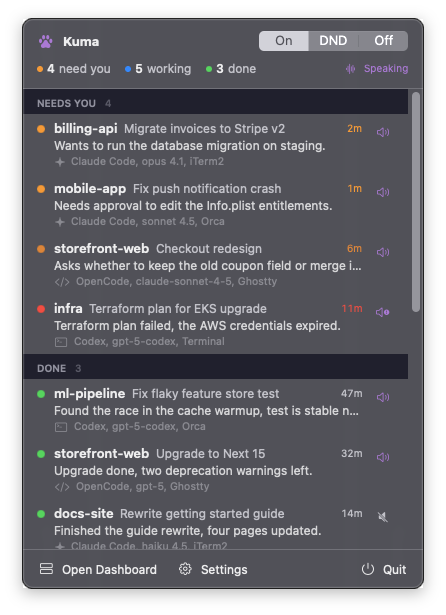
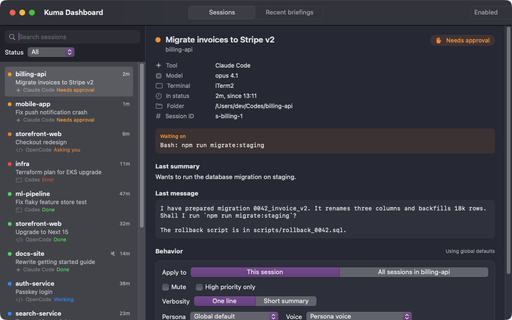
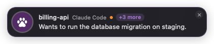
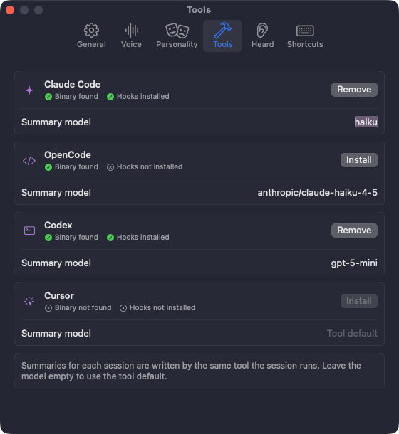

# Kuma

Kuma is a macOS menu bar app that watches all of your AI coding sessions at once (Claude Code, OpenCode, Codex and Cursor CLI, running in iTerm2, Terminal, Ghostty or Orca), summarizes what each one did, and reads you short prioritized briefings out loud. Sessions that need an approval or are asking you a question come first.

It is named after Bartholomew Kuma from One Piece: big, quiet, and always delivering news.

## Screenshots

| Menu bar | Dashboard |
| --- | --- |
|  |  |

| Paw bubble | Settings |
| --- | --- |
|  |  |

More in [docs/screenshots](docs/screenshots).

## Features

- Menu bar dropdown with every session sorted by urgency, plus a full dashboard window.
- Modes: Enabled, Do Not Disturb (only high priority is spoken) and Disabled.
- Per session control: mute, high priority only, one line or short summary, persona or voice override, and which events speak (finished, approvals, questions, errors, subagents). Apply it to one session or to every session in the project.
- Briefings are stacked and read one after another. While Kuma speaks, a paw bubble shows at the bottom of the screen. Click it to skip, click the small x to clear the stack, or press Option and Esc from anywhere.
- Local Kokoro voice, nothing leaves your Mac.

## Requirements

- macOS 14 or later
- Xcode command line tools with Swift 5.10 or later

## Build and install

- `swift build` builds everything in debug.
- `swift run Kuma` runs the app from the repo with mock data.
- `scripts/bundle.sh` produces `build/Kuma.app`, signed ad hoc.
- `scripts/bundle.sh --install` also copies it to `~/Applications/Kuma.app`, then `open ~/Applications/Kuma.app`.

The app bundle contains:

- `Contents/MacOS/Kuma`, the app
- `Contents/Helpers/kuma-hook`, the tiny CLI the agent hooks call
- `Contents/Resources/AppIcon.icns`, `MenuBarGlyph.png` and `MenuBarGlyph@2x.png`
- `Contents/Resources/voice/`, copied from `Resources/voice` when present
- `Contents/Resources/Integrations/`, copied from `Integrations` when present

Set `KUMA_MOCK=0` to start without mock data. Useful launch flags while developing: `--dashboard`, `--settings`, `--demo` (queues a few briefings) and `--menu` (shows the dropdown content in a normal window).

## Permissions

- No Accessibility permission is needed. The Option and Esc shortcut uses a Carbon hot key, registered only while Kuma is speaking. Plain Esc is never captured, so you can still interrupt Claude Code.
- Launch at login uses the system login items service. You can review it in System Settings, General, Login Items.
- The app is signed ad hoc. On first launch macOS may ask you to confirm opening it: right click Kuma.app and choose Open.

## How hooks work

Kuma installs a small hook into each tool you enable (Settings, Tools). When the agent finishes, asks for approval, asks a question, hits an error or a subagent stops, the tool runs `kuma-hook`, which forwards the event over a local socket in `~/Library/Application Support/Kuma/` and exits immediately. If Kuma is not running the hook does nothing, so your agents are never slowed down.

Kuma then asks the same tool the session runs to write a one line summary (Claude Code summarizes Claude Code sessions, and so on), queues a briefing and speaks it. Summary calls are tagged so they never trigger hooks themselves. Remove the hooks any time from Settings, Tools.

If you used Heard before, Settings, Heard can remove its hooks so you do not hear every update twice.

## Troubleshooting

- **No icon in the menu bar:** on a crowded menu bar macOS hides extra icons behind the notch. Quit a few menu bar apps or use a menu bar manager.
- **Sessions do not appear:** check Settings, Tools. The tool binary must be found and the hooks installed. Restart the agent session after installing hooks.
- **No voice:** Settings, Voice shows the Kokoro status. Use Install if it is missing, then Test voice. Check the mode is not Disabled.
- **Option and Esc does nothing:** another app may own that shortcut. The bubble still skips on click.
- **Two copies running:** Kuma allows a single instance. Launching it again opens the dashboard of the running copy.
- **Logs:** `~/Library/Application Support/Kuma/kuma.log`.
