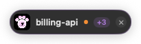
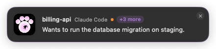
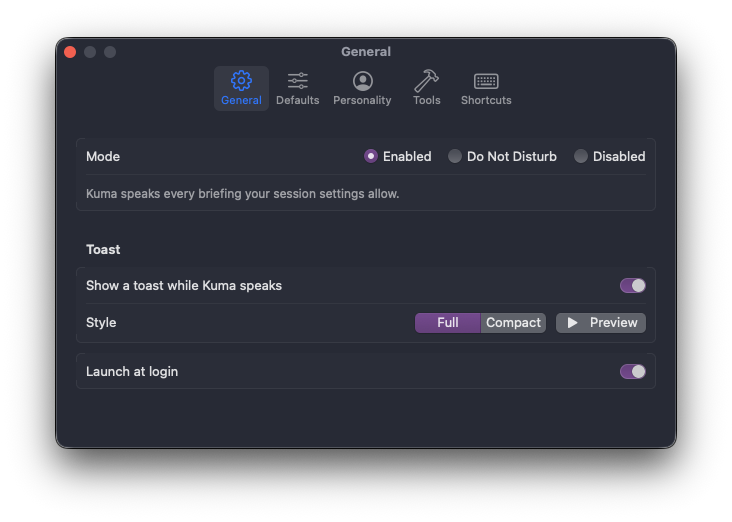
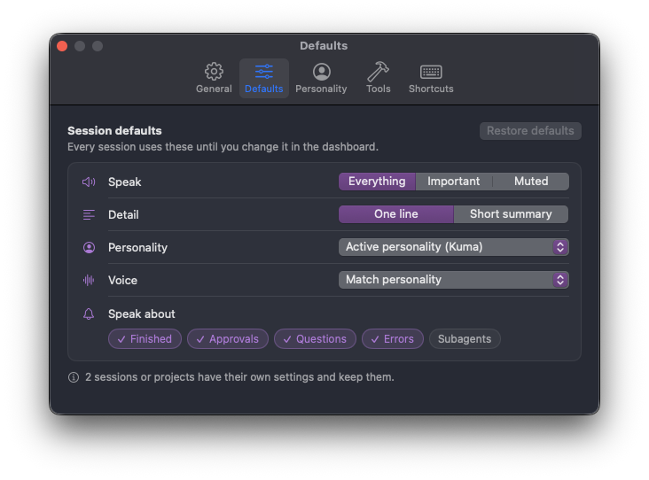
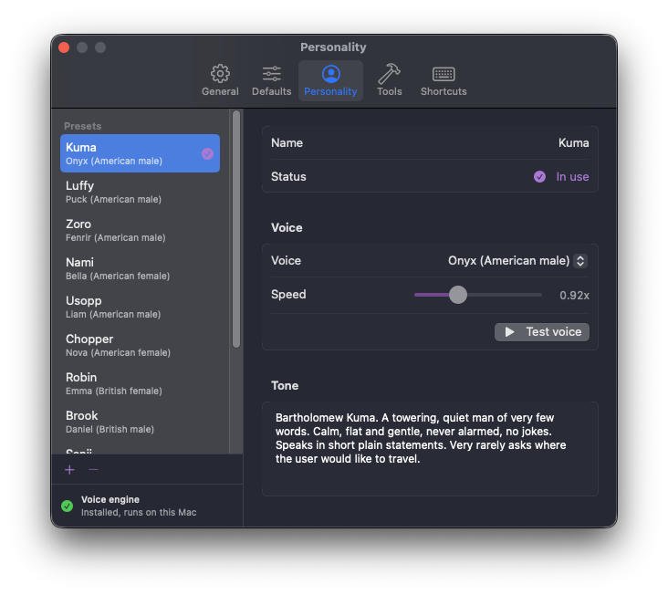
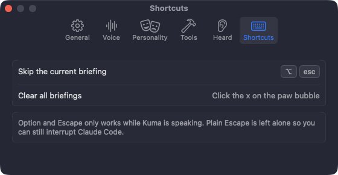
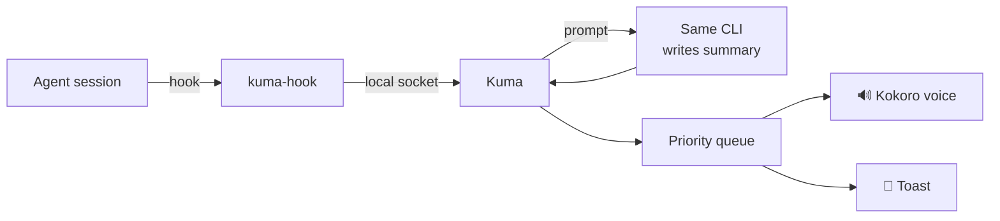

<div align="center">



# Kuma

**Your AI coding sessions, briefed out loud.**

A native macOS menu bar app that watches every Claude Code, OpenCode, Codex and Cursor session you run, summarizes what each one did, and speaks short, prioritized briefings in a local voice.

[](#-requirements)
[](Package.swift)
[](#-install)
[](#-voice)
[](https://github.com/mindantic/kuma/releases/latest)

[Install](#-install)  |  [Features](#-features)  |  [Screenshots](#-screenshots)  |  [Personalities](#-personalities)  |  [How it works](#%EF%B8%8F-how-it-works)  |  [Troubleshooting](#-troubleshooting)

</div>

---

> [!NOTE]
> Kuma is named after Bartholomew Kuma from One Piece: big, quiet, and always delivering news.

When you run twenty agent sessions at once, the hard part is knowing which one needs you. Kuma listens to all of them and tells you, in order of urgency: approvals and questions first, errors next, everything else after.

## ✨ Features

| | |
| --- | --- |
| 🎙️ **Spoken briefings** | One short sentence per update, read in a natural local voice. Briefings queue up and play one after another. |
| 🚦 **Prioritized** | Approvals, questions and errors jump the queue. Do Not Disturb speaks only what needs you. |
| 🧭 **Menu bar + dashboard** | Every session sorted by urgency in the menu bar, plus a full dashboard with details, last message and history. |
| 🍞 **Toasts** | A compact (default) or full toast shows the moment Kuma starts speaking. Click to skip, ✕ to clear the queue. |
| ⌨️ **Global skip shortcut** | ⌘ Esc by default, recordable in Settings. Plain Esc stays free for your agent. |
| 🎭 **Personalities** | Kuma, the Straw Hat crew and Jarvis, each with its own voice and way of talking. Make your own too. |
| 🎛️ **Per session control** | Mute, important only, one line or short summary, personality and voice, which events speak. Per session, per project, or as defaults. |
| 🧠 **Honest summaries** | The same CLI that runs the session writes its summary. Kuma never claims work is complete, it says what the agent reported. |
| 🔒 **Private** | The voice runs on your Mac. Summaries use the CLIs you already have, with your own accounts. |

### Supported tools

| Tool | Hooks | Summaries |
| --- | :---: | :---: |
| Claude Code | ✅ | ✅ |
| OpenCode | ✅ | ✅ |
| Codex | ✅ | ✅ |
| Cursor CLI | ✅ | ✅ |
| Your own command | | ✅ |

Works in iTerm2, Terminal, Ghostty, Orca and other terminals.

## 📸 Screenshots

<table>
  <tr>
    <td align="center" width="38%"><b>Menu bar</b><br></td>
    <td align="center"><b>Dashboard</b><br></td>
  </tr>
</table>

<table>
  <tr>
    <td align="center"><b>Compact toast (default)</b><br></td>
    <td align="center"><b>Full toast</b><br></td>
  </tr>
</table>

<details open>
<summary><b>Settings</b></summary>

<table>
  <tr>
    <td align="center"><b>General</b><br></td>
    <td align="center"><b>Defaults</b><br></td>
  </tr>
  <tr>
    <td align="center"><b>Personality</b><br></td>
    <td align="center"><b>Tools</b><br></td>
  </tr>
  <tr>
    <td align="center"><b>Shortcuts</b><br></td>
    <td></td>
  </tr>
</table>

</details>

## 📦 Install

### Option 1: Download the app

1. Download the latest **`Kuma-x.y.z.dmg`** from [Releases](https://github.com/mindantic/kuma/releases/latest).
2. Open it and drag **Kuma** into **Applications**.
3. Open Kuma. The paw appears in your menu bar.

> [!WARNING]
> **macOS will say Kuma "can't be opened" the first time.** Kuma is signed ad hoc and not notarized by Apple, so Gatekeeper blocks it. This happens once:
>
> 1. Try to open Kuma, then click **Done** on the warning.
> 2. Open **System Settings → Privacy & Security**.
> 3. Scroll down to **Security**, find *"Kuma" was blocked*, and click **Open Anyway**.
> 4. Confirm with **Open Anyway** and your password.
>
> Prefer Terminal? This does the same thing:
>
> ```sh
> xattr -dr com.apple.quarantine /Applications/Kuma.app
> ```

### Option 2: Build from source

No Gatekeeper prompt, since you build it yourself. Needs macOS 14+ and the Xcode command line tools (`xcode-select --install`).

```sh
git clone https://github.com/mindantic/kuma.git
cd kuma
scripts/bundle.sh --install
open ~/Applications/Kuma.app
```

This builds a release version, signs it ad hoc and installs it to `~/Applications/Kuma.app`. Run the same commands again after a `git pull` to update.

### First run

1. **Tools:** open **Settings → Tools**, pick each tool you use and click **Install hooks**. Restart running agent sessions so they pick up the hooks.
2. **Voice:** click **Install** on the *Voice not installed* banner in the menu, or in **Settings → Personality**. It downloads Kokoro (about 340 MB) once, with progress shown as it goes. Nothing else is needed: if Python isn't on your Mac, Kuma fetches its own copy.
3. **Personality:** pick one, click **Use this personality** and **Test voice**.

That's it. The next time an agent stops, asks or needs approval, Kuma tells you.

## 🎭 Personalities

| | Personality | Voice | Style |
| :---: | --- | --- | --- |
| 🐻 | **Kuma** | Onyx | Quiet, calm, very few words |
| 👒 | **Luffy** | Puck | Cheerful and loud, *shishishi* |
| ⚔️ | **Zoro** | Fenrir | Gruff, blunt, terse |
| 🍊 | **Nami** | Bella | Sharp navigator, a bit bossy |
| 🎯 | **Usopp** | Liam | Dramatic Captain Usopp, nervous about errors |
| 🩺 | **Chopper** | Nova | Earnest little doctor |
| 📚 | **Robin** | Emma | Calm archaeologist, dry humor |
| 🎻 | **Brook** | Daniel | Gentleman skeleton, *yohohoho* |
| 🍳 | **Sanji** | Michael | Smooth cook, kitchen talk |
| 🔧 | **Franky** | Adam | SUPER loud shipwright |
| 🤖 | **Jarvis** | George | Polished British butler, *sir* |

Every preset can be edited in place and restored later. Add your own with **+**. The character only changes the wording, never the facts.

## 🗣 Voice

Kuma speaks with [Kokoro](https://github.com/thewh1teagle/kokoro-onnx), a small text to speech model that runs on your Mac. Nothing you hear is sent anywhere.

The installer sets up everything in `~/Library/Application Support/Kuma/voice`. It uses [uv](https://docs.astral.sh/uv/) if you have it, otherwise it downloads uv and a private Python 3.12 into that folder. Your system Python and shell config are never touched. Until the voice is installed, Kuma uses the built in macOS voice.

## ⚙️ How it works



1. Kuma installs a tiny hook in each tool you enable. When the agent stops, asks for approval, asks a question, hits an error or a subagent stops, the tool runs `kuma-hook`.
2. `kuma-hook` forwards the event over a local socket in `~/Library/Application Support/Kuma/` and exits right away. If Kuma isn't running it does nothing, so agents are never slowed down.
3. Kuma asks a CLI to write a one line summary. By default each tool summarizes its own sessions, which you can change in **Settings → Tools**. Summary calls are tagged so they never trigger hooks themselves.
4. The briefing is queued by priority and spoken.

Remove the hooks any time from **Settings → Tools**.

### Modes

| Mode | What Kuma speaks |
| --- | --- |
| 🟢 **Enabled** | Everything your session settings allow |
| 🟠 **Do Not Disturb** | Only approvals, questions and errors |
| ⚪ **Disabled** | Nothing. Sessions are still tracked |

## 🔐 Permissions

- **No Accessibility permission.** The skip shortcut is a Carbon hot key, registered only while Kuma speaks.
- **Launch at login** uses the system login items service. Review it in **System Settings → General → Login Items**.

## 🛠 Development

See [Build from source](#option-2-build-from-source) to install. Swift 5.10 or later.

| Command | What it does |
| --- | --- |
| `swift build` | Debug build of everything |
| `swift test` | Run the test suite |
| `swift run Kuma --mock` | Run with mock sessions |
| `scripts/bundle.sh` | Build `build/Kuma.app` |
| `scripts/bundle.sh --universal` | Same, for Apple Silicon and Intel |
| `scripts/release.sh` | Universal build plus `dist/Kuma-<version>.dmg`, `.zip` and checksums |

Handy launch flags while developing: `--mock`, `--dashboard`, `--settings`, `--menu` (menu content in a window) and `--demo` (queues a few briefings).

<details>
<summary><b>What's inside Kuma.app</b></summary>

| Path | Purpose |
| --- | --- |
| `Contents/MacOS/Kuma` | The app |
| `Contents/Helpers/kuma-hook` | Tiny CLI the agent hooks call |
| `Contents/Resources/AppIcon.icns` | App icon, rendered from `Assets/app-icon.svg` |
| `Contents/Resources/voice/` | Voice installer and runner |
| `Contents/Resources/Integrations/` | OpenCode plugin |

</details>

## 🩺 Troubleshooting

<details>
<summary><b>No paw in the menu bar</b></summary>

On a crowded menu bar macOS hides extra icons behind the notch. Quit a few menu bar apps or use a menu bar manager.
</details>

<details>
<summary><b>Sessions don't appear</b></summary>

Check **Settings → Tools**: the tool must be found and its hooks installed. Restart the agent session after installing hooks.
</details>

<details>
<summary><b>No voice</b></summary>

Open **Settings → Personality** and check the voice engine status at the bottom left. Click **Install** if needed, then **Test voice**. Make sure the mode isn't Disabled.
</details>

<details>
<summary><b>Summaries come from the wrong tool or model</b></summary>

Open **Settings → Tools**, pick the tool and set **Summarize with**, the command path and the model. Click **Test** to see the reply and how long it took.
</details>

<details>
<summary><b>The skip shortcut does nothing</b></summary>

Another app may own that shortcut. Record a different one in **Settings → Shortcuts**. Clicking the toast always skips.
</details>

<details>
<summary><b>Coming from Heard</b></summary>

Run `kuma-hook admin remove-heard` once so you don't hear every update twice.
</details>

Logs live in `~/Library/Application Support/Kuma/kuma.log`.

---

<div align="center">
<sub>Made with 🐾 by <a href="https://github.com/mindantic">Mindantic</a></sub>
</div>
